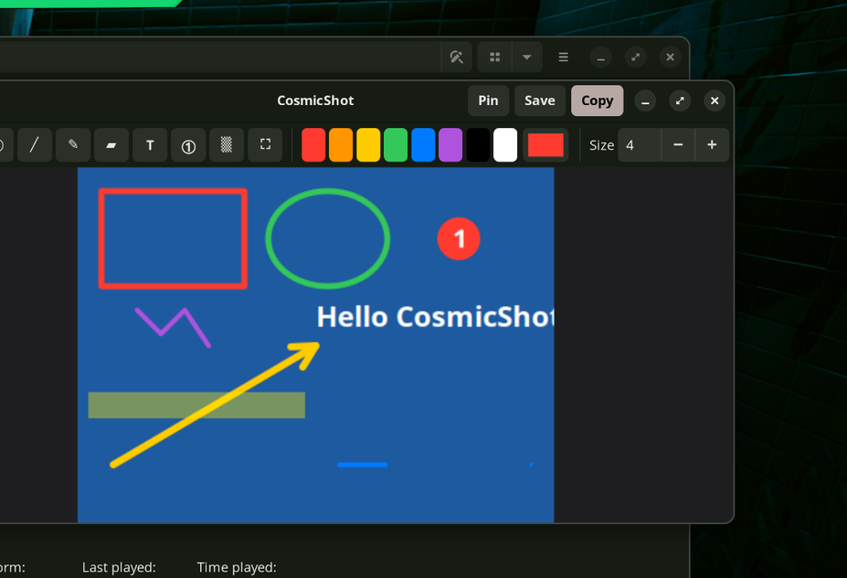
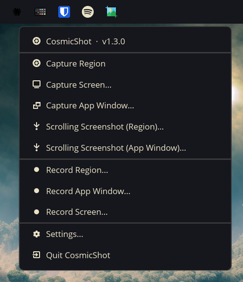

# CosmicShot

A **CleanShot X-style** screenshot, **screen-recording** + annotation tool for
**Pop!_OS / COSMIC on Wayland**.

The stock COSMIC screenshot tool captures fine but can't annotate on the spot.
CosmicShot fills that gap: drag-select a region over a dimmed desktop, land
straight in an editor to draw arrows, boxes, text, blur sensitive bits, add
numbered steps — and **copy, save, or upload a shareable link**. It also records
video, takes scrolling screenshots, and lives in your panel as a tray icon.



<p align="center">
  
</p>
<p align="center"><em>Capture, record, and settings — one click from the panel.</em></p>

## Install

**Pop!_OS / COSMIC** — one line adds the signed APT repository and installs:

```bash
curl -fsSL https://davidboulay.github.io/CosmicShot/install.sh | sudo bash
```

New versions then arrive automatically with `sudo apt upgrade`.

<details>
<summary>Prefer to run the steps yourself?</summary>

```bash
sudo install -d -m 0755 /etc/apt/keyrings
sudo curl -fsSL https://davidboulay.github.io/CosmicShot/cosmicshot-archive-keyring.gpg \
  -o /etc/apt/keyrings/cosmicshot.gpg
echo "deb [signed-by=/etc/apt/keyrings/cosmicshot.gpg] https://davidboulay.github.io/CosmicShot stable main" \
  | sudo tee /etc/apt/sources.list.d/cosmicshot.list
sudo apt update && sudo apt install cosmicshot
```
</details>

Requires the COSMIC desktop (`cosmic-screenshot`); screen recording also needs
PipeWire + GStreamer (see [Screen-recording dependencies](#screen-recording-dependencies)).
No-repo options are in [Other ways to install](#other-ways-to-install).

## Features

- **Dimmed region selector** — drag to select with a live `W × H` readout,
  crosshair, and resize handles. Multi-monitor aware. `Esc` cancels.
- **Capture modes** — **region**, a whole **screen**, or a specific **app window**.
- **Scrolling screenshots** — capture a long region or window and scroll;
  CosmicShot stitches the frames into one tall image.
- **Screen recording** — record a **region**, **app window**, or **whole screen**
  to MP4 (H.264) via the ScreenCast portal + GStreamer.
  - Optional audio (off by default): a quick dialog lets you pick **no sound**,
    **system sound (PC output)**, or a **microphone**.
  - A **red ● recording control** lets you Stop/Cancel; for full-screen the Stop
    button moves to the panel (a red ⏹) so nothing of CosmicShot is in the
    recording. You can also stop from a hotkey bound to `cosmicshot record --stop`.
  - After recording, a **preview player** with a scrubbable timeline — draggable
    playhead, elapsed / total, restart, `Space` to play-pause, and frame-accurate
    seeking so you can land on the exact frame you want. It holds on the last
    frame rather than looping. Then **Save As…** (remembers the last folder) or
    **Discard**.
  - **Trim before saving**, QuickTime-style: drag either **yellow end** of the
    timeline inward to cut off a false start or a fumbled ending. What falls
    outside is dimmed, and playback stays inside the kept range so you see
    exactly what you'll get. `[` and `]` trim to the playhead; **Reset trim**
    puts it all back. **Save trimmed** re-encodes just that range, so the cut
    lands on the frame you chose instead of snapping to the nearest keyframe (a
    hardware-encoded capture can hold a single one) — audio comes along.
- **Instant annotation editor** with tools:
  - **Direct manipulation with any tool** — hover a shape (it highlights), drag
    its body to move or a handle to resize; arrows/lines have endpoint handles,
    boxes have 8. New shapes are auto-selected. `Delete` removes the selection;
    changing the colour re-colours it. The **Select** tool (`V`) rearranges only.
  - Arrow, Rectangle, Line — **Snap 15°** (on by default) locks lines and
    arrows to fixed angles, including perfectly straight ones; hold `Shift` for
    a free angle.
  - **Ellipse** — **Circle** (off by default) forces a perfect circle while
    drawing *and* while resizing; hold `Shift` for a circle on demand.
  - Freehand Pen
  - **Highlighter** (marker) — **Straight** (on by default) lays one straight,
    angle-snapped stroke so it follows a line of text exactly; hold `Shift` (or
    untick it) to draw freehand. Highlights can be moved and deleted but never
    resized — scaling a marker stroke only smears it.
  - **Text boxes** — type in place with a real caret: arrow-key navigation,
    word jumps, `Shift`-selection, `Ctrl+A`, click/drag to select, double-click a
    word, and text copy/cut/paste. **Click a text to re-edit** it. The box
    auto-grows and wraps when you drag a handle to set a width (resizing changes
    the **box width, never the font**). Left / centre / right / justify.
  - **Copy / paste elements** — `Ctrl+C` / `Ctrl+X` / `Ctrl+V` duplicate the
    selected annotation.
  - **Blur / pixelate** for redacting sensitive info — adjustable strength
  - **Spotlight / focus** — darkens everything outside a resizable box
  - **Numbered step counters** (auto-incrementing)
  - **Crop** — drag, then **Apply crop** (or `Enter`); keep annotating cropped.
    A **Ratio** dropdown holds a strict aspect (`1:1`, `4:3`, `3:4`, `3:2`,
    `2:3`, `16:9`, `9:16`) or **Free**; the outlined rect never leaves the image,
    so a locked ratio survives the edges. `Shift` frees a set ratio, or squares
    a free crop.
  - Context-aware style control: Thickness / Snap angle / Straight / Circle /
    crop Ratio / Font size / Blur / Darkness — only the one that applies shows.
- **Undo / redo** (full history, including crop, move, and resize).
- **Close confirmation** — closing with unsaved edits asks Save / Discard / Cancel.
- **Cloud upload** — one click uploads and copies a shareable URL to your
  clipboard (default host: catbox.moe — free, no account, permanent). `Ctrl+U`.
- **Copy to clipboard** or **Save PNG** — the toolbar buttons (or `Ctrl+S`).
- **Settings** — version, one-click updates, global keyboard shortcuts, and the
  upload host (or no Upload button at all).
- **Panel tray icon** with a capture/record menu, auto-started at login.

## Other ways to install

The [APT repository](#install) above is the recommended way. Alternatives:

### Single `.deb` download

Download the latest `cosmicshot_*.deb` from the
[**Releases page**](https://github.com/davidboulay/CosmicShot/releases/latest), then
`sudo apt install ./cosmicshot_*.deb`. You won't get automatic `apt upgrade`s this
way, but the in-app updater (Settings → Check for updates) still works.

Either way you get the `cosmicshot` command, a desktop entry, icons, and a login
autostart for the panel tray icon. Remove it with `sudo apt remove cosmicshot`.

### Per-user script (no root)

```bash
sudo apt install python3-gi python3-gi-cairo python3-pil python3-requests \
                 gir1.2-gtklayershell-0.1 gir1.2-ayatanaappindicator3-0.1 wl-clipboard
./install.sh
```

Copies the app to `~/.local/share/cosmicshot`, a launcher to `~/.local/bin`, a
desktop entry, and a tray autostart. Uses your system Python packages.

### Screen-recording dependencies

For the **Record** features, also install:

```bash
sudo apt install python3-gst-1.0 gstreamer1.0-pipewire \
                 gstreamer1.0-plugins-good gstreamer1.0-vaapi gstreamer1.0-plugins-bad
```

(`gstreamer1.0-libav` provides the AAC encoder used when you record audio.)

## Usage

```bash
cosmicshot                       # region capture (default) → edit
cosmicshot region                # same
cosmicshot screen                # pick a whole screen → edit  (alias: full)
cosmicshot window                # pick an app window → edit
cosmicshot scroll --target region   # scrolling screenshot of a region
cosmicshot scroll --target window   # scrolling screenshot of an app window
cosmicshot record --target region   # record a region to MP4
cosmicshot record --target window   # record an app window
cosmicshot record --target screen   # record a whole screen
cosmicshot record --stop            # stop the recording in progress (bind a hotkey)
cosmicshot open --file shot.png      # edit an existing image
cosmicshot settings                  # version / updates / shortcuts
cosmicshot tray                      # run the panel tray icon
```

### Tray icon (CleanShot-style menu)

The installer starts the tray automatically at login. It adds an icon to the
COSMIC panel with a capture/record menu, plus **Settings…**. While a full-screen
recording is running the icon turns into a red ⏹ **Stop recording** button, and
that is the only thing the menu offers — **Quit is hidden while recording**, since
picking it by mistake used to kill the panel while the recording carried on in the
background with no way to stop it. Quit comes back the moment the recording ends.

> Needs `gir1.2-ayatanaappindicator3-0.1` (present on most COSMIC installs; the
> `.deb` recommends it).

### Settings

Open **Settings…** from the tray (or `cosmicshot settings`):

- **Version & updates** — see the installed version, **Check for updates**, and
  **Update now** (downloads the latest `.deb` and installs it via `pkexec`).
  Tick **Automatically check for updates** to be notified when a new release
  lands.
- **Global keyboard shortcuts** — assign a key combination per capture action.
  These are written into COSMIC's custom-shortcuts config so they work
  system-wide. Empty by default (a re-login guarantees COSMIC picks them up).

### Editor keys

| Key | Action | Key | Action |
|-----|--------|-----|--------|
| `V` | Select / move / resize | `T` | Text |
| `A` | Arrow | `N` | Step number |
| `R` | Rectangle | `B` | Blur |
| `E` | Ellipse | `X` | Crop |
| `L` | Line | `Delete` | Delete selected shape |
| `P` | Pen | `O` | Spotlight / focus |
| `H` | Highlighter | `Ctrl+Z` / `Ctrl+Shift+Z` | Undo / Redo |
| `Ctrl+C` / `Ctrl+X` / `Ctrl+V` | Copy / cut / paste the **selected element** | `Ctrl+S` | Save |
| `Ctrl+U` | Upload & copy URL | `Enter` | Apply pending crop |
| `Shift` (while drawing) | Invert the active constraint | `Esc` | Deselect / cancel crop |

The editor is only left through its **Copy**, **Save**, **Upload** or window-close
buttons — `Esc` never closes it, and `Ctrl+C` copies the selected annotation
rather than the whole image.

While typing in a text box: arrow keys / `Home` / `End` move the caret
(`Ctrl` for whole words), `Shift` extends the selection, `Ctrl+A` selects all,
`Ctrl+C` / `Ctrl+X` / `Ctrl+V` work on the text, click or drag inside the box to
place the caret or select a range, double-click a word, triple-click for
everything. `Shift+Enter` adds a line, `Enter` or `Esc` finishes the box.

## Configuration

Most things live in **Settings** (tray menu → Settings): updates, global
shortcuts, and the **cloud upload** host — pick catbox.moe / uguu.se / 0x0.st,
enter a custom endpoint, or untick *Show the Upload button* to remove uploading
from the editor altogether.

Everything else is in `~/.config/cosmicshot/config.json` (created on first run).
It must be **strict JSON** — no `//` comments and no trailing commas; a file that
fails to parse is ignored (with a warning on stderr), which looks exactly like
"my edits do nothing". The comments below are just for this README. Notable keys:

```jsonc
{
  "save_dir": "~/Pictures/Screenshots",
  "filename_pattern": "CosmicShot_%Y-%m-%d_%H-%M-%S.png",
  "default_color": "#ff3b30",
  "default_width": 4,
  "palette": ["#ff3b30", "#ff9500", "...", "#ffffff"],
  "pixelate_block": 12,        // default blur tool strength
  "spotlight_darkness": 0.6,   // 0..0.95
  "angle_snap_lock": true,     // lines/arrows snap to 15° (Shift inverts)
  "highlight_straight": true,  // highlighter draws one straight stroke
  "ellipse_circle_lock": false,// ellipse forces a perfect circle
  "crop_ratio": "Free",        // or "1:1", "4:3", "3:4", "3:2", "2:3", "16:9", "9:16"
  "auto_copy_on_capture": false,
  "copy_on_save": true,        // also copy when saving / pinning
  "auto_update": false,        // check GitHub for updates on launch + periodically
  "video_save_dir": null,      // last folder used to save a recording

  // Cloud upload (Upload button / Ctrl+U). Default: catbox.moe (permanent).
  "upload_enabled": true,      // false removes the Upload button and Ctrl+U
  "upload_service": "https://catbox.moe/user/api.php",
  "upload_field": "fileToUpload",   // multipart file field name
  "upload_extra": { "reqtype": "fileupload" }   // extra form fields
}
```

Any host that takes a multipart `POST` and answers with the URL (plain text, or
JSON such as `{"url": …}` / `{"files": [{"url": …}]}`) works as a custom
endpoint — e.g. uguu.se is `"upload_service": "https://uguu.se/upload.php",
"upload_field": "files[]", "upload_extra": {}`.

> **Uploads are public.** Anyone with the URL can view the image and nothing is
> encrypted — use the blur/spotlight tools to redact before uploading.

## How it works

Wayland forbids apps from reading the framebuffer directly, so CosmicShot grabs
the desktop via `cosmic-screenshot` (the COSMIC screenshot portal) for stills,
and via the **ScreenCast portal → PipeWire → GStreamer** for video. It then
renders **its own** overlay/editor on top with `gtk-layer-shell`; rendering is
cairo. Region recordings record the monitor and crop to the rectangle.

```
cosmicshot/
  app.py        orchestration + CLI
  capture.py    cosmic-screenshot wrapper + monitor geometry
  overlay.py    dimmed region selector + screen/window pickers + scroll capture
  scroll.py     scrolling-screenshot frame stitcher
  record.py     ScreenCast-portal recording (pipeline, control, preview, trim)
  audio.py      audio-source discovery + picker
  windows.py    per-window geometry (COSMIC toplevel-info protocol)
  editor.py     annotation editor window (canvas, toolbar, undo/redo)
  tools.py      annotation primitives (arrow, rect, text, blur, …)
  imaging.py    PIL ↔ cairo, pixelate/blur source
  export.py     render → clipboard / disk / png bytes
  pin.py        floating always-on-top pinned screenshot
  tray.py       panel tray icon + recording Stop + update checks
  settings.py   settings window (version, updates, shortcuts)
  updates.py    GitHub release check + .deb install via pkexec
  shortcuts.py  writes CosmicShot shortcuts into COSMIC's config
  config.py     settings
```

## Troubleshooting

- **Nothing happens / "no file"** — ensure `cosmic-screenshot` works:
  `cosmic-screenshot --interactive=false --save-dir /tmp`.
- **Recording produces no video** — install the GStreamer packages above and
  check an H.264 encoder is present (`gst-inspect-1.0 vah264enc`).
- **Overlay doesn't appear** — check `gir1.2-gtklayershell-0.1` is installed.
- **Copy does nothing** — install `wl-clipboard`; verify with `wl-paste --list-types`.
- **No tray icon** — install `gir1.2-ayatanaappindicator3-0.1`, then run `cosmicshot tray`.
- **`cosmicshot: command not found`** (script install) — add `~/.local/bin` to your `PATH`.

## License

MIT.
